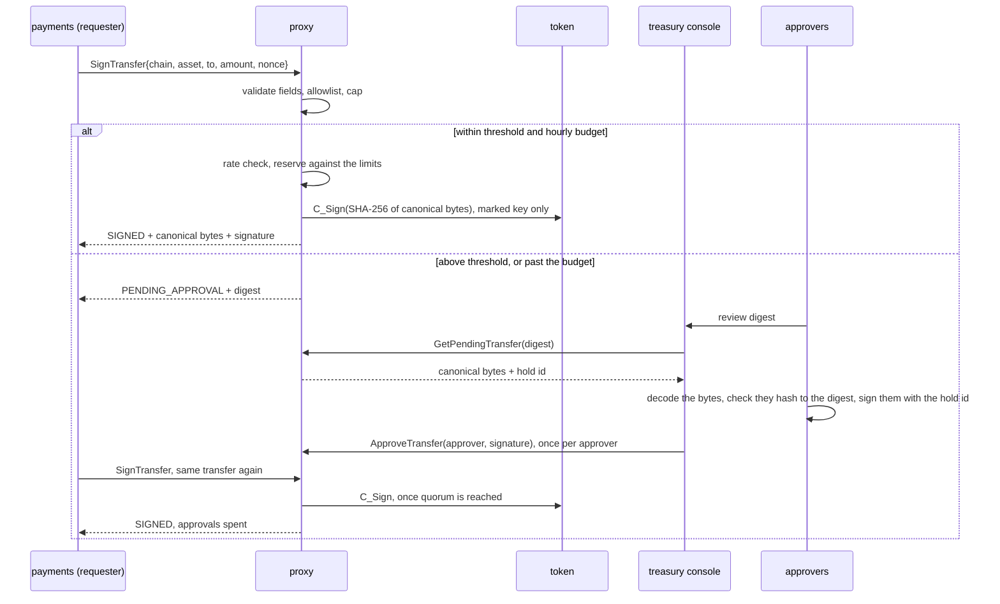

# M10 — transfer keys: signing what the proxy has read

Status: **built and demonstrated.** `make transfer-demo` runs a transfer key end to end
over mTLS against a real SoftHSM token, and asserts 16 outcomes. CI runs it on every
pull request. This milestone was added after the original plan.

## The pattern

Every other key here signs opaque bytes. Authorization decides *who* may use a key, but
the proxy cannot tell what it is signing, so a compromised caller with a valid grant can
get anything signed. For most keys that is the right trade: the proxy is fast precisely
because it does not care what the bytes mean. For keys whose signatures carry meaning, it
makes the proxy a signing oracle:

| A signature that… | What a blind signer would sign for an attacker |
|---|---|
| moves money | a payment to the attacker's account |
| releases software | the attacker's build, as a trusted release |
| issues a certificate | a certificate for a domain the attacker does not control |

The fix has the same shape in each case. The caller describes the request in fields,
not bytes. The signer checks the fields against a policy, builds the exact bytes it
signs, and holds the risky requests until enough people approve them. The checks live
beside the key, so compromising a caller does not get around them. A check upstream of a
signer that trusts its callers stops nothing once that upstream service falls.

M10 builds this for one kind of request: a transfer of value. Some parts do not depend
on the request type and would carry over to another: the transfer-only marker on the
token, the workers' refusal to blind-sign, approver keys, and the approval check. The
encoding, the policy, and the limits are specific to transfers.

None of this makes the proxy a wallet. It holds no balances, talks to no blockchain, and
sends nothing anywhere. It signs, and whatever moves the value sits in front of it.

## Why transfers first

Because of the October 2026 Binance incident. An exchange keeps most of its funds in
cold wallets, whose keys are offline, and a working float in hot wallets, whose keys
stay online so that withdrawals can be signed automatically. By the public accounts at
the time of writing, no private key was extracted. The signer behind the hot wallet
signed what an attacker sent it, including EIP-7702 delegations that no withdrawal flow
should ever produce. The key was protected and its *use* was not.

That signer is this kind of proxy, and this proxy had the same gap. A compromised
`payments` service holds a valid certificate and a valid grant, so to the generic `Sign`
it is indistinguishable from the real thing. The HSM guarantees the key cannot leave. It
does not guarantee the key is only used for what it is for.

## Against the four usual recommendations

| Recommendation | Here |
|---|---|
| Parse the transaction instead of signing a blind hash; destination allowlists, value and velocity limits | **Built.** A transfer key signs only through `SignTransfer`, which takes fields, never bytes. The proxy validates the fields, applies the policy, and builds the exact bytes it signs. A per-key, per-asset allowlist, per-transfer cap, approval threshold, rolling hourly budget, and per-minute rate. |
| Quorum approval for large or unusual transfers | **Built.** Above the threshold, or past the hourly budget, a transfer is held until *m* of *n* approvers sign it with their own keys. |
| MPC or multisig, with independent checks at each signer | **Not built.** The final signature is still one key, in one token, behind one proxy. See [what this does not cover](#what-this-does-not-cover). |
| Humans verify on a separate device | **Partly.** An approval is a signature over the full transfer, not a hash, and the approver's client decodes and displays it itself. In the demo that client runs on the same machine as everything else. |

## How a transfer flows



The requester learns the outcome by resubmitting the same transfer, with the same nonce.
A transfer is identified by its bytes, so resubmitting is idempotent until the hold is
approved, and an approved hold is collected exactly once.

## Why a compromised caller cannot get a blind signature

Four layers, each enforced separately, so a mistake in one is caught by the next:

1. **Authorization.** No identity may be granted `sign` on a transfer key. The proxy
   refuses to start with a policy that grants it (demo step 1b), and also refuses one
   granting `sign_transfer` or `approve_transfer` on an ordinary key.
2. **The handler.** `Sign` on any key named in `policy/transfers.toml` returns
   `PERMISSION_DENIED`, in both backends. This is what applies when mTLS is off and
   authorization cannot run.
3. **The token.** The key is created with `CKA_ID = "gll:transfer-only"`,
   `CKA_MODIFIABLE=false`, and `CKA_COPYABLE=false`. The worker that owns each session
   refuses a generic signature on a marked key, and a transfer signature on an unmarked
   one, whatever the policy file or proxy mode. The marker cannot be rewritten or shed by
   copying the key into an unmarked twin; `tests/transfer.rs` checks both against
   SoftHSM, with controls showing that the same operations succeed on an ordinary key. At
   startup the proxy checks that every transfer key in the policy is marked on the token,
   and refuses to start otherwise.
4. **The encoding.** What gets signed is built by the proxy from validated fields: a
   domain tag, a kind byte, length-prefixed ASCII strings, and fixed-width integers.
   There is no field a caller can use to smuggle in other bytes. The decoder is strict,
   so there is exactly one encoding of each transfer. Strings are restricted to plain
   ASCII so that a destination with a Cyrillic lookalike, a right-to-left override, or a
   zero-width space is refused rather than displayed as something it is not. The pinned
   test vector was checked against a separate implementation of the documented layout.

## The policy

`policy/transfers.toml`, per key and per (chain, asset):

| Rule | Kind | Approval lifts it? |
|---|---|---|
| `destinations` | hard: anything else is refused | no |
| `max_per_transfer` | hard: larger is refused | no |
| `approval_above` | hold: larger needs a quorum | yes |
| `auto_sign_per_hour` | hold: once the rolling hour's signed total would pass it, everything is held | yes |
| `max_transfers_per_minute` (per key) | refused until the minute passes | no |

Some decisions behind those rules:

- **Amounts are decimal strings, never floats.** They are compiled into the asset's
  smallest unit with exact integer arithmetic, and anything ambiguous is refused: `.5`,
  `1.`, signs, exponents, separators, leading zeros (which some systems read as octal),
  and more decimal places than the asset has.
- **Approved transfers count against the hourly budget.** They are real outflow. An
  approval lets a transfer through the budget; it does not make the transfer invisible to
  the next one.
- **The rate limit is not lifted by approvals.** It bounds how fast the key can move
  value even with people in the loop, which is what turns a compromise into an incident
  rather than an emptied account.
- **Check and reserve happen under one lock.** Two concurrent requests cannot both fit
  under the budget's last remaining room. The signature itself is made outside the lock.
  If it fails, the reservation is released, and an approved hold goes back with its
  approvals, so a transient HSM error costs nobody their work.
- **Windows are bucketed.** The hour is 60 one-minute buckets and the minute is 60
  one-second buckets, so memory is fixed per key and asset, whatever the traffic.

## Approvals

- **An approver is a name and a pinned P-256 public key**, read from
  `certs/approvers/<name>.pub`. A CA compromise cannot mint approvers. The private halves
  are created by `scripts/gen-certs.sh` in `.local/approvers/`, which is never mounted
  into the proxy container, and the proxy has no setting that would point it there.
- **An approval is an ECDSA P-256 signature over `"gll-approval-v1\0" || hold id ||
  canonical bytes`.** Its domain tag differs from the transfer's, so an approval can
  never pass as a transfer signature or the reverse. It covers the full transfer rather
  than a digest, so a hardware signer with a screen could decode and display what it is
  signing.
- **An approval counts for one hold.** Each hold gets 16 fresh random bytes as its
  identifier, and approvers sign them along with the transfer. Without that, the
  approvals for a transfer would cover its bytes for good. Once the transfer was signed,
  whoever had relayed them could replay them onto a new request for the identical
  transfer, approving it with no approver involved. Replayed approvals are refused,
  whether they name the old hold or the new one, which a unit test checks.
- **The approver's client does not trust the proxy's summary.** `transfer approve` fetches
  the held bytes, checks they hash to the digest it was asked about, decodes and displays
  them, and signs those exact bytes. A proxy that displayed one transfer and held another
  would collect an approval that verifies for neither. That is the Bybit failure: the
  approvers there signed what a compromised interface showed them.
- **Separation of duties is checked at load.** The proxy refuses a policy granting one
  identity both `sign_transfer` and `approve_transfer` on the same key. The `treasury`
  identity relays approvals; it can neither approve on its own, since that takes the
  approvers' keys, nor request transfers.
- **Holds are bounded.** They expire after `hold_ttl_secs` (default 15 minutes), there are
  at most `max_pending` per key, and only the identity that requested a transfer can
  collect it.

## What it costs

`Sign` with a digest on `demo-ec-p256` against `SignTransfer` on the demo transfer key, both
over mTLS, pool with 4 workers, concurrency 8, 8,000 requests per run, 7 interleaved
rounds. Limits were raised so they would not throttle the load. Measured on a local
Apple M2 with background load, so reported only as ratios, per the benchmarking policy.
Each figure is the median of the per-round ratios:

| `SignTransfer` / `Sign` | Throughput | p50 | p99 | Errors |
|---|---|---|---|---|
| audit logging off (`RUST_LOG=warn`) | 0.975 | 1.021 | 1.028 | 0 |
| audit logging on (the default) | 0.959 | 1.076 | 1.051 | 0 |

The policy work itself costs about 2–3%: validation, the encoding, SHA-256, one lock, and
two window updates, against a signature that dominates the request either way. About as
much again is the audit trail: one structured log line per transfer decision, written
synchronously. That cost is accepted rather than optimised away. These are not reference
figures; a reference run would be needed to publish absolute numbers.

## What this does not cover

- **Code execution on the proxy host.** The token is in the proxy's address space, and
  anyone who can run code there has the PIN and can call `C_Sign` directly. The marker
  binds this proxy, not PKCS#11. This design moves the trust boundary to the proxy; it
  does not remove it. Removing it takes MPC or an on-chain multisig, so that no single
  host can sign alone, or an HSM that enforces the policy inside its own boundary.
- **No MPC or multisig.** A real version would run the same decoder and policy at each
  independent signer, so a compromise of one is outvoted by the others. The canonical
  encoding and approval messages are designed so that each signer can check the same
  bytes.
- **State is in memory.** A restart resets the windows and drops the holds. Instances do
  not share limits, so *N* proxies allow *N* times the budget. Production would need the
  windows and holds in a shared store updated atomically, or a single signing instance.
- **The policy file is a trust root.** Whoever can edit `policy/transfers.toml` can add a
  destination or raise a limit, so it belongs under the same review as code. It is read
  at startup only.
- **Allowlists fit transfers between known accounts, not arbitrary payouts.** Moving
  funds to a reserve or a settlement account suits a fixed list. Paying out to addresses
  that customers supply needs different controls: per-customer limits, address
  screening, and delay windows.
- **It is not a real chain's format.** A deployment would build, for example, an
  EIP-1559 transaction from the checked fields, and refuse every other transaction type,
  EIP-7702 authorizations included. The property that matters, that the signer builds the
  bytes from fields it checked, carries over unchanged.
- **The proxy does not track nonces.** Replay protection is the chain's job, and signing
  identical bytes twice produces the same transfer, not a second one.
- **Limits are per asset, in that asset's units.** There is no cross-asset value limit,
  which would need a price feed.
- **Two stolen approver keys make a quorum.** In the demo those keys sit on disk on the
  same machine. For real, each belongs on its approver's own device.

## Running it

```bash
make transfer-demo
```

This needs the release binaries (`cd proxy && cargo build --release --bins`) and a
provisioned native token. It creates any certificates and approver keys that are missing,
starts its own proxy on a spare port with fresh limits, and plays both sides: the
requester and the approvers. It asserts each step, and ends with the transfer metrics and
the audit log.

| Step | Expected |
|---|---|
| a made-up digest sent to `Sign` on the transfer key | `PERMISSION_DENIED` |
| proxy started with a policy granting `sign` on it | refuses to start |
| 1.5 ETH to the reserve account | signed, and verified locally over the decoded bytes |
| 0.01 ETH to an unlisted address | refused: not on the allowlist |
| 300 ETH | refused: over the 250 ETH cap |
| 25 ETH | held: above the 10 ETH threshold |
| the requester approving its own transfer | `PERMISSION_DENIED` |
| alice's approval signed with bob's key | refused: does not verify |
| alice approves, the requester resubmits | 1 of 2, still held |
| bob approves, the requester resubmits | signed, 2 of 2 |
| the same transfer again | held from 0 of 2: approvals are spent |
| 9 + 9 + 9 ETH | the third is held: past the 50 ETH hourly budget |

Against the compose stack, which loads the same policy, use the CLI directly:

```bash
T=proxy/target/release/transfer
$T --as payments sign --key demo-transfer-key --chain devnet --asset ETH \
   --to 0xc01dc01dc01dc01dc01dc01dc01dc01dc01dc01d --amount 25 --nonce 1
$T --as treasury approve --key demo-transfer-key --digest <digest> --approver alice
```

Without `--yes`, `approve` shows the decoded transfer and waits for the approver to type
`approve`.

Metrics: `hsm_transfers_total{key_label, outcome, reason}`,
`hsm_transfer_approvals_total{result, reason}`, `hsm_transfers_pending`, and
`hsm_transfer_outflow_last_hour` beside `hsm_transfer_auto_sign_budget_per_hour`, both
per key, chain and asset. Labels come from the policy, never from what a caller sent, so
a caller cannot grow the label set by inventing names.

## Where the code is

| Path | What |
|---|---|
| `proxy/src/transfer/canonical.rs` | the transfer format, amount parsing, approval message |
| `proxy/src/transfer/policy.rs` | loading and validating `policy/transfers.toml`, cross-checks against authz |
| `proxy/src/transfer/velocity.rs` | bucketed rolling windows |
| `proxy/src/transfer/guard.rs` | sign, hold, or refuse; holds and approvals |
| `proxy/src/pkcs11/worker.rs` | the token-level refusal |
| `proxy/src/pkcs11/provision.rs` | creating a marked, non-modifiable, non-copyable key |
| `proxy/src/bin/transfer.rs` | the requester and approver CLI |
| `proxy/tests/transfer.rs` | the token-level guarantees, against SoftHSM |
| `scripts/transfer-demo.sh` | the demo, and the CI check |
