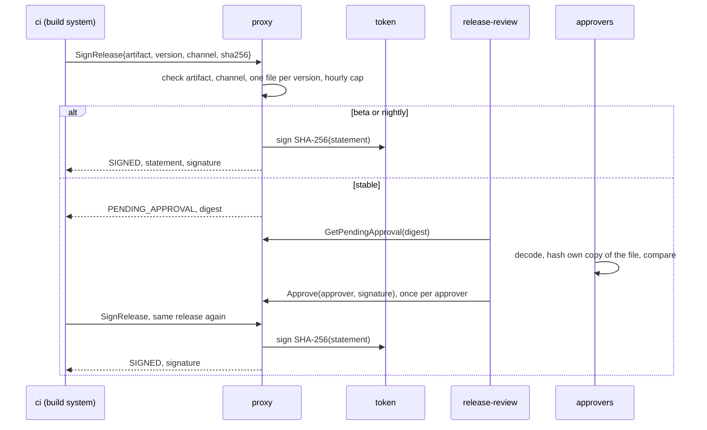

# M11 — release keys: the same pattern, for software

Status: **built and demonstrated.** `make release-demo` runs a release key end to end
over mTLS against a real SoftHSM token, and asserts 22 outcomes. CI runs it on every
pull request, beside the transfer demo. This milestone was added after the original plan.

## Why a second purpose

[M10](m10-transfer-keys.md) built signing-what-the-proxy-has-read for transfers of value.
Nothing about the proxy is specific to money, though, and the transfer format is a
stand-in: no blockchain would accept it. M11 applies the same pattern to a second kind
of request, software releases, for two reasons:

- **It shows the pattern is general.** The parts that do not depend on the request type
  are now shared code that both purposes use: the token marker, the workers' refusal to
  blind-sign, approver keys, holding and approving, the rolling windows, and the
  startup cross-checks. A third purpose, such as certificates, would add a format, a
  policy and a guard, and reuse the rest.
- **The format is complete as it stands.** A release statement names a file by its
  SHA-256, so anyone holding the public key can check a downloaded file against it, with
  no other software in the loop. `release verify` does exactly that.

A release signature is what an updater or a package manager checks before installing
something. A build system that can get anything signed with the release key can ship
anything to every user, as a trusted release. That is the same signing-oracle problem as
a hot wallet's signer, with a different payload.

## How a release flows



The build system never sends bytes to sign. It sends four fields, and the proxy builds
the statement it signs from them. As with transfers, the requester learns the outcome
of a hold by asking again with the identical release, and an approved hold is collected
exactly once.

## What gets signed

The statement is the 15 bytes `"gll-release-v1\0"`, a kind byte, four length-prefixed
ASCII strings — key label, artifact, version, channel — and the 32-byte SHA-256 of the
file. The signature is ECDSA P-256 over SHA-256 of the statement, raw `r || s`. The
decoder is strict, so there is exactly one encoding of each release, and the pinned test
vector was checked against a separate implementation of the documented layout.

Some decisions behind it:

- **The channel is signed.** Beta builds sign on their own, so a beta signature must not
  pass as a stable one. An updater on the stable channel rebuilds the statement with
  `stable` in it, and a beta signature does not verify against that (demo step 6).
- **A version has one spelling.** Versions are strict semantic versions with no build
  metadata and no leading zeros. Otherwise `1.4.0` and `1.4.0+build.7`, or `1.4.0` and
  `01.4.0`, would be two versions to the proxy and one to a user, and the
  one-file-per-version rule below would not mean much.
- **The key label is in the statement.** A signature by one release key never stands for
  another's, even if the two keys were ever the same.
- **Strings are plain ASCII**, for the same reason as transfers: an artifact name with a
  Cyrillic lookalike or an invisible character is refused rather than shown to an
  approver as something it is not.

## The policy

`policy/releases.toml`, per key:

| Rule | Kind | Approval lifts it? |
|---|---|---|
| `artifacts` | hard: anything else is refused | no |
| a channel in neither list | hard: refused | no |
| one file per version | hard: a version signed or held for one file is refused for any other | no |
| `approval_channels` | hold: every release to these waits for a quorum | yes |
| `auto_sign_channels` | signed at once | — |
| `max_releases_per_hour` | refused until the hour has room | no |

- **There is no stable release small enough to wave through.** Transfers have an
  amount, so small ones can sign on their own. Releases do not, so the line is drawn by
  channel instead.
- **One file per version.** Once `gll-proxy 1.4.0` is signed for one file, the key
  refuses `1.4.0` for any other file, on any channel. A build system compromised after a
  release shipped cannot re-sign that release as something else for users who pin the
  version. Approvers are never shown two different files under one version number,
  either: a version held for one file is refused for any other. Promoting a build from
  `beta` to `stable` is the same file, so it is allowed.
- **Approved releases count against the hourly cap.** As with transfers, an approval
  lifts the hold, not the rate. The cap bounds how many auto-signed builds a compromised
  build system can mint under fresh version numbers (demo step 12).
- **Check and record happen under one lock.** Two concurrent requests for one version
  with different files cannot both pass. If the signature then fails, the hour and any
  approvals go back, but the version stays bound to its file: an identical request
  in flight at the same time may have been signed. Retrying with the same file works.

## Approvals

Approving works exactly as it does for transfers: approvers are names with pinned P-256
public keys, an approval signs `"gll-approval-v1\0" || hold id || statement`, it counts
for one hold only, and only the identity that asked can collect. See
[M10's approvals](m10-transfer-keys.md#approvals).

What differs is what an approver checks. **`release approve` needs the approver's own
copy of the file**, fetched or rebuilt independently, and refuses to sign unless it
hashes to the file the held statement names (demo step 9). The proxy can check that a
release is allowed. Only someone holding the build can check that it is the right build.

The demo reuses the transfer approvers' keys. That is safe: every statement begins with
its format's tag, and an approval signs the whole statement, so an approval of a release
can never count as an approval of a transfer, or the other way round.

## Why a compromised build system cannot get a blind signature

The same four layers as transfer keys, each enforced separately:

1. **Authorization.** `ci` is granted `sign_release`, never `sign`. The proxy refuses to
   start with a policy granting `sign` on a release key (demo step 1b), granting one
   identity both `sign_release` and `approve` on a key, or granting `sign_release` on a
   key that is not a release key.
2. **The handler.** `Sign` on any key in `policy/releases.toml` returns
   `PERMISSION_DENIED`, in both backends, mTLS on or off.
3. **The token.** The key is created with `CKA_ID = "gll:release-only"`,
   `CKA_MODIFIABLE=false`, and `CKA_COPYABLE=false`. The workers refuse a generic
   signature on it, and refuse to sign a release with a key not marked release-only —
   including a transfer key. `tests/purpose_keys.rs` checks both purposes against
   SoftHSM, including that neither marker can be rewritten as the other. At startup the
   proxy checks that every key in each policy carries the matching marker.
4. **The encoding.** The proxy builds the statement from validated fields, and its tag
   differs from every other format's, so a release signature cannot be presented as
   anything else.

## What this does not cover

- **A malicious build that the approvers also receive.** Approvers compare the held
  hash with their own copy, and that check is only as independent as the copy. If the
  build itself was poisoned, as in the SolarWinds compromise, where malicious code was
  inserted during the build and the result was signed with the company's own
  certificate, approvers who download the same artifact from the same pipeline will
  approve it. Reproducible builds, where approvers rebuild from source and compare,
  close that gap. They are not built here.
- **Auto-signed channels sign on their own.** Whoever controls the build system can get
  up to `max_releases_per_hour` beta and nightly builds signed. Users on those channels
  will trust them. The signed channel stops those builds passing as stable; the cap
  bounds how many there are.
- **The record lives in memory.** The hourly window and the one-file-per-version record
  reset when the proxy restarts, and each replica keeps its own. After a restart, a
  version could be signed again for a different file. A durable, shared record would
  fix that. So would publishing every signature to an append-only transparency log, as
  Sigstore does, which lets anyone see two files signed under one version even if the
  signer is compromised.
- **No rollback protection.** A statement does not expire, so an updater that trusts the
  key trusts every release it ever signed, old vulnerable ones included. The updater must
  refuse versions older than the one installed. Frameworks such as TUF handle rollback
  and freeze attacks; this is not one.
- **Not a standard format.** An updater has to know this statement layout. Standard
  tooling, such as an in-toto statement in a DSSE envelope, would need the proxy to build
  those bytes instead. Which bytes the proxy builds is the only part that would change.
- **A compromised proxy host can still sign alone**, as for transfer keys. Only MPC or
  multisig removes that.

## What it costs

Not measured. Releases are a handful a day, so throughput is beside the point. The
checks are a lock, a few map lookups and a short encoding before the same ECDSA
signature as any other P-256 key, and `SignRelease` follows the same path through the
worker pool as `SignTransfer`, whose cost [M10 measured](m10-transfer-keys.md#what-it-costs).

## Trying it

```bash
make release-demo
```

Against the compose stack, which loads the same policy, use the CLI directly:

```bash
R=proxy/target/release/release
$R --as ci sign --key demo-release-key --artifact gll-proxy --version 1.4.0 \
   --channel stable --file dist/gll-proxy
$R --as release-review approve --key demo-release-key --digest <digest> \
   --approver alice --file ~/independent-copy/gll-proxy
$R --as ci sign ...        # the same release again, to collect the signature
$R --as ci verify --key demo-release-key --artifact gll-proxy --version 1.4.0 \
   --channel stable --file gll-proxy --signature <hex>
```

Without `--yes`, `approve` shows the decoded release and waits for the approver to type
`approve`. `verify` fetches the public key through the proxy for convenience; an updater
would pin the public key and never talk to the proxy at all.

Metrics: `hsm_releases_total{key_label, outcome, reason}`, `hsm_releases_pending`, and
`hsm_approvals_total{purpose="release", result, reason}`. Labels come from the policy,
never from what a caller sent.

## Where the code is

| Path | What |
|---|---|
| `proxy/src/release/statement.rs` | the release format and version rules |
| `proxy/src/release/policy.rs` | loading and validating `policy/releases.toml` |
| `proxy/src/release/guard.rs` | sign, hold, or refuse; the one-file-per-version record |
| `proxy/src/approval.rs` | holds, approvals and the authz cross-checks, shared with transfer keys |
| `proxy/src/velocity.rs` | bucketed rolling windows, shared |
| `proxy/src/encoding.rs` | the field encoding both formats are built from |
| `proxy/src/pkcs11/session.rs` | the purpose markers |
| `proxy/src/cli.rs` | the approver's side of both CLIs |
| `proxy/src/bin/release.rs` | the build-system, approver and verifier CLI |
| `proxy/tests/purpose_keys.rs` | the token-level guarantees for both purposes, against SoftHSM |
| `proxy/tests/policies.rs` | the shipped policies load and agree with each other |
| `scripts/release-demo.sh` | the demo, and the CI check |
